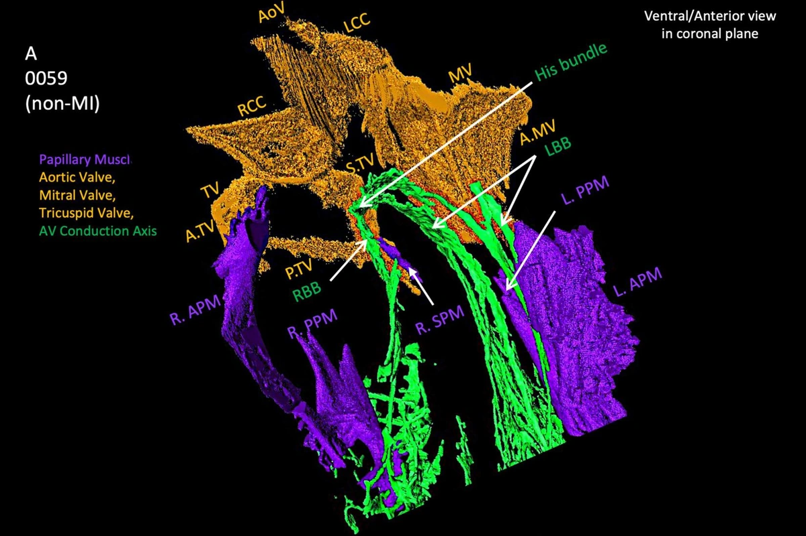
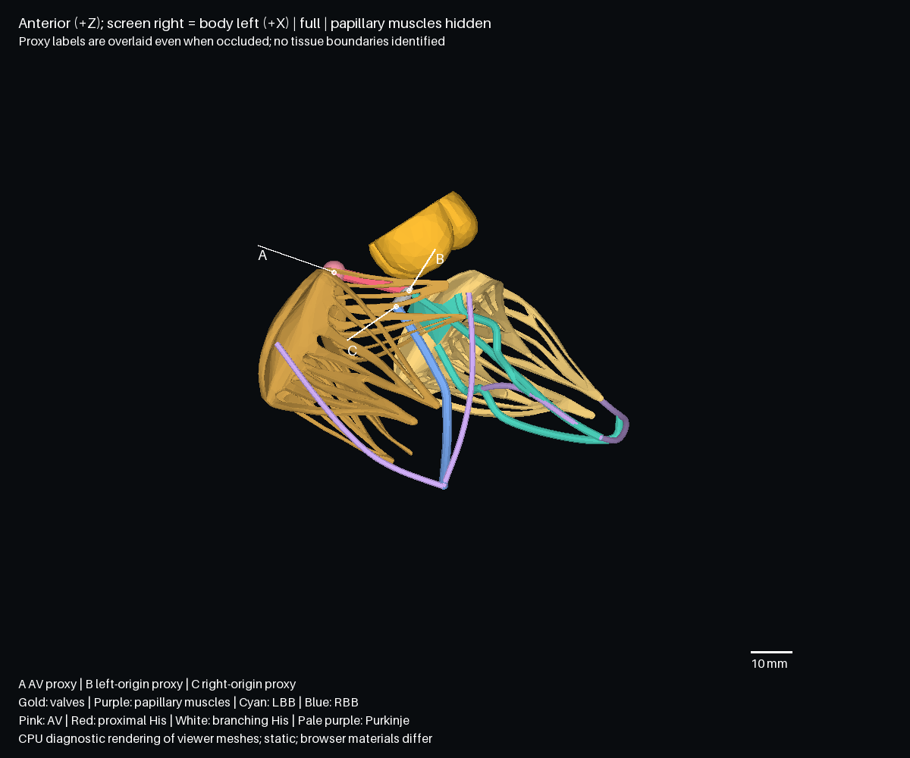

# 図6Aと現行の刺激伝導系の対応

対象は main `876759d` の配布形状。初回確認は2026-11-08、レビュー対応は2026-11-09（日本時間）。

## 今回の判断

Chenら（2025）の図6Aと、現行ビューアーの弁、乳頭筋、房室伝導系の形状を描画して比較した。
三弁の大まかな並びは前面投影で一致した。左右脚の近位方向は心臓の長軸をそろえていないため判定を保留した。右脚が向かう乳頭筋には標本0059との違いがある。
現行モデルが使う部品では緻密房室結節の末端、膜性中隔の下縁、ヒス束の貫通部と分岐部の境界を同定できず、文献と同じ測定点を置けない（BodyParts3D全体の部品は検索していない）。
組織位置の定量照合は未実施で、[READMEの設計判断](../../README.md#設計判断)に従い今後の作業対象外とする。

## 直接確認した資料と図の範囲

- [Chenら2025、本文§3.5、図6の説明](https://www.frontiersin.org/journals/medicine/articles/10.3389/fmed.2025.1507005/full)
- [図6の原画像](https://www.frontiersin.org/files/Articles/1507005/xml-images/fmed-12-1507005-g006.webp)

原文HTMLと画像を直接取得し、モデルとの比較には非心筋梗塞標本0059のパネルAを用いた。
パネルBとCの心筋梗塞標本を正常配置の根拠には用いない。
パネル右上の視点表示は、冠状面を前方から見た図であることを示す。His、LBB、RBBの各矢印と、弁、乳頭筋の略号を比較に用いた。
このパネルにはAV結節の末端と貫通部の境界を個別に追える表示がないため、図のHisという矢印だけをモデルの区間境界に対応させない。

§3.5は貫通束と膜性中隔の下縁、幅広い左脚近位部を説明する。
約6mm、約8mmという記述は大動脈洞、分岐束、弁付着面などの関係であり、弁尖表面への最短距離とは異なる。
補足図S6A–Dの画像は今回は閲覧していない。
本研究とStephensonら2017は標本0059を共有するため、独立した2心の再現確認とはしない。

## 描画方法と目視範囲

`parseObj`の `(x,y,z) → (x,z+補正,-y)` と、`decodeAnatomy`の復号を確認した。
+X＝身体の左、+Y＝上、+Z＝前、単位mm。
`createConduction`が生成するメッシュと、配布用バイナリ中の弁、乳頭筋メッシュを、そのまま頂点と三角形として書き出した。
壁、血管、洞房結節、心房経路は非表示にし、静止形状を使った。

初回のローカルChromiumは起動時の `socket() failed: Operation not permitted` で終了した。
VTKもXサーバー接続エラーで終了したため、NumPyとPillowによるCPU描画を使った。
三角形の重心順ではなく、画素ごとの重心座標補間と深度バッファで前後を判定する。
表裏を描き、面ごとの照明と診断用の色を用いる。
診断用描画は正投影で、通常ビューアーの材質、法線補間、透視投影、UIとは条件が異なる。

| 視点 | 全体 | 局所拡大 | 画面の軸 |
|---|---|---|---|
| 前面 | [画像](../validation/conduction-front-2026-11-08.png) | [画像](../validation/conduction-front-local-2026-11-08.png) | 右＝身体の左、上＝上方 |
| 身体の右側 | [画像](../validation/conduction-right-2026-11-08.png) | [画像](../validation/conduction-right-local-2026-11-08.png) | 右＝前方、上＝上方 |
| 上面 | [画像](../validation/conduction-top-2026-11-08.png) | [画像](../validation/conduction-top-local-2026-11-08.png) | 右＝身体の左、上＝後方 |

初回に7枚を原寸で確認し、レビュー対応で色を変更した8枚を再確認した。
白いA/B/Cの指示線は遮蔽に関係なく重ねている。
近位側と分岐側の接続は、[弁と乳頭筋を外した前面拡大](../validation/conduction-front-paths-2026-11-08.png)で追える。

## 図6Aとモデルの前面比較

| Chenら（2025）図6A、標本0059 | モデル前面、乳頭筋のみ非表示 |
|---|---|
|  |  |

左図は Chenら、*Frontiers in Medicine* 12:1507005（2025）、[図6](https://doi.org/10.3389/fmed.2025.1507005)より。
© 2025 Chen, Kuniewicz, Aminu, Karaesmen, Duong, Proniewska, van Dam, Iles, Hołda, Walocha, Iaizzo, Colman, Dobrzynski and Atkinson。
[CC BY 4.0](https://creativecommons.org/licenses/by/4.0/)に基づき、パネルAの範囲を切り出し、下端左右に残るB・Cの表示を黒で除き、幅1200pxに縮小した。
図は比較記録に掲載した。配布HTMLには含めていない。

モデルの通常の診断用前面像では、乳頭筋が僧帽弁と起始目印の一部を遮る。
右図では乳頭筋だけを外し、各弁の見えている面にTV・MV・AoVの指示線を付けた。
両図は前面から見た像で、心臓の長軸の傾きや縮尺をそろえていない。
一致としたのは、前面投影で読み取れる弁の並びと、大動脈弁とヒス束の大まかな上下関係である。

| 比較項目 | 判定 | 並置した図と本文§3.5で確認した根拠 |
|---|---|---|
| 三尖弁（TV） | 一致 | 画面左側にある。パネルAの左上寄りのTV・A.TVと、モデルの左側の弁が対応する。 |
| 僧帽弁（MV） | 一致 | 画面右側にある。パネルA右上のMV・A.MVと、モデルで乳頭筋を外すと見える右側の弁を比べた。 |
| 大動脈弁（AoV） | 一致 | 三弁のうち上部中央寄りにある。パネルA上端のAoVと、モデルのBより上方にある弁を比べた。 |
| ヒス束と右冠尖（RCC） | 一致（大動脈弁との大まかな上下関係）／判定不能（右冠尖に対する位置、組織境界） | パネルAのHis矢印はRCCの下を示す。モデルのヒス束も大動脈弁の下方を通る。比較像では三つの大動脈弁尖を個別に標示しておらず、Bは無冠尖と右冠尖の近くに置く規則から得た点なので、右冠尖との対応を独立に検証できない。 |
| 左脚（LBB） | 判定保留（近位方向）／判定不能（起始範囲、幅、遠位の付着） | パネルAではLBBが画面の下方へ伸び、モデルの青緑の経路は右への張り出しが大きく見える。心臓の長軸をそろえていないため、近位方向の一致も不一致も判定できない。左後乳頭筋は元データに含まれず、そこへの付着を照合できない。 |
| 右脚（RBB） | 判定保留（近位方向）／不一致（標本0059とモデルで向かう乳頭筋） | パネルAとモデルの経路は画面下方に伸びる。長軸をそろえていないため、心臓に対する方向の判定は保留する。モデルの右脚は右前乳頭筋の基部へ向かう。 |

本文§3.5によると、非心筋梗塞標本0059では左右両脚が後乳頭筋へ向かう傾向がある。
一方、同節で対比した二つの心筋梗塞標本では、右脚がより右前乳頭筋へ向かう傾向がある。

### 目印と組織境界の対応

| 目印または区間 | 表示上の意味 | 組織との対応 |
|---|---|---|
| A | 三尖弁中隔尖の付着部候補から選んだ、房室結節を示す点 | トダロ腱、中心線維体、緻密房室結節末端を元データで同定できない。図6Aから球の中心や半径を確定できない。 |
| A→B | 房室結節の目印から左脚の目印へ進む近位区間 | 膜性中隔の下縁に対応する部品がなく、貫通部の範囲を判定できない。 |
| B→C | 左脚側から右脚側の目印へ進む分岐区間 | Bで左脚、Cで右脚へ接続する。貫通部と分岐部の境界、右脚の組織上の起始は元データで同定できない。 |

## 既存値の区間別整理と追加計測

A→BとA→Cは[既存の端点計測](his-landmark-validation-2026-11-08.md)と同じ丸め済みデータから再計算した。
今回の追加はB→Cの区間値と、各目印から弁尖までの距離。

[全値と軸、入力ハッシュ](../validation/conduction-figure6a-2026-11-08.json)を保存した。
以下は丸め済みの表示用データからの計測で、組織学的な長さではない。

| 表示区間 | 端点差（左、上、前）mm | 両端直線距離 | 描画曲線長 |
|---|---|---:|---:|
| A→B、近位区間 | 18.2、−4.5、−2.0 | 18.854mm | 18.854mm |
| B→C、分岐区間 | −3.0、−3.9、+6.9 | 8.475mm | 8.475mm |

各区間は2点のCatmull–Rom曲線なので、今回の曲線長は直線距離と一致する。
A→Cの全体では前へ4.9mm進む一方、A→Bは後ろへ2.0mm進む。
終点の定義だけで前後の符号が変わるため、全体の符号の一致を貫通部の位置の検証には使わない。

補助として、A/B/Cから表示用の弁尖三角形への三次元最短距離を測った。
Aから大動脈弁10.33mm、三尖弁0.017mm、僧帽弁28.09mm、Bからは順に4.64、12.21、17.05mm、Cからは8.97、4.48、22.15mmだった。
Aは三尖弁の候補点から選んだため、近さは独立した検証にならない。
簡略化した表示面との距離であり、原OBJの頂点への距離や弁輪平面への距離と混ぜない。
表示メッシュ上で付着縁を弁尖面の部分集合とみなせる場合、弁尖面までの距離はその付着縁までの距離の下限になる。
その条件では、Aから僧帽弁の付着縁までの距離の下限は約28.09mmで、20mmを超える。
Bは三つの弁尖面から20mm未満だが、下限だけでは付着縁までの距離が20mm以内か判定できない。
解剖学的な付着面までの距離に、この下限をそのまま適用することはできない。

論文§3.5では、標本0059の房室伝導軸（AVCA）が三弁から20mm未満の距離にあると述べる。
この記述からは、各弁に最も近いAVCA上の点を指すのか、AVCA上の全点が条件を満たすのか、弁のどの面を基準にしたのかは確定できない。
最短距離の読み方では、Aが20mmを超えても他の点で条件を満たしうるが、Bの下限値だけでは確認できない。
全点に適用する読み方で、Aを軸上の対応点、表示上の付着縁を同じ測定対象と仮定すれば、Aと僧帽弁の組は条件から外れる。
点と測定対象の対応が未確定のため、20mmをモデルの合否判定には用いない。

## 再現と残る作業

この記録を再現するときは、この文書と描画スクリプトを含む同じコミットを使う。
リポジトリのルートで実行する。Python 3.12の検証環境ではNumPy 2.3.5とPillow 13.0.0を使用した。
フォントはPillow同梱のものを使用する。

```sh
npm ci
scratch=$(mktemp -d)
python3 -m venv "$scratch/venv"
"$scratch/venv/bin/python" -m pip install numpy==2.3.5 Pillow==13.0.0
node scripts/inspect-conduction.mjs "$scratch/input.json"
"$scratch/venv/bin/python" scripts/render-conduction.py "$scratch/input.json" "$scratch/rendered" 2026-11-08
cmp "$scratch/rendered/conduction-figure6a-2026-11-08.json" docs/validation/conduction-figure6a-2026-11-08.json
```

書き出しスクリプトは出力ファイルの指定を必須とし、既存ファイルへの書き込みを拒否する。
描画スクリプトは既存ディレクトリを出力先に指定すると、書き込み前に終了する。
更新が必要な場合は新しい出力を確認してから対象ファイルを差し替える。
[初回の証拠](https://github.com/Panda4th/Human-heart-3D-model/tree/aafb05c51e5888500cce13bbe0bfab34f1ce3230/docs/validation)は初回コミットから参照できる。
配布HTMLのSHA-256は `21173c36fe81a61ced7791d3172afe80dc1fef6fa126cfd5b534a9194816690c`。

Stephenson図3とChen補足図S6A–Dは、論文標本の組織境界を読むための資料候補として残す。
現行モデルに文献と対応する目印が得られるまで、文献画像を追加しても座標修正の根拠にはできない。

レビュー対応時は、ビルドと単体テスト66件が成功した。
配布HTMLと `src/` は対象のmainとバイト単位で一致した。
診断画像8枚と計測JSONを再生成し、同じ出力が得られることを確認した。
書き出し先の省略、既存ファイル、既存の描画ディレクトリをそれぞれ拒否することを確認した。
ローカルChromiumは今回もソケット権限エラーで起動できなかった。
